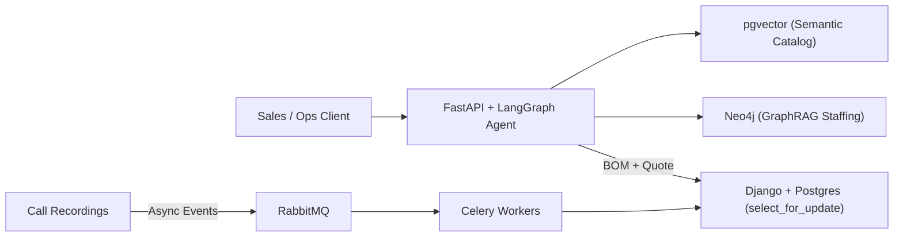
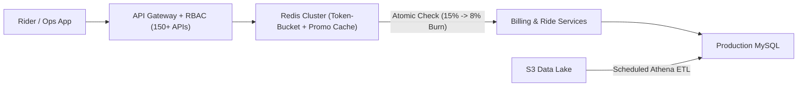

### Hi, I'm Anirudh Agrawal 👋

**Senior Backend & Distributed Systems Engineer** in Bengaluru | **IIT Roorkee '20** | **ex-Yulu**, **ex-Meragi**

I design and scale high-concurrency microservices, event-driven pipelines, and production AI systems.

#### What I've Built in Production
- **AI & Event-Driven Systems (Meragi):** Architected a `LangGraph` + `FastAPI` + `pgvector` sales assistant (60% faster turnaround), a `Celery`/`RabbitMQ` meeting-intelligence CRM pipeline, a high-concurrency `Django`/`Elasticsearch` inventory system (10,000+ items with pessimistic locking), and a `Neo4j` GraphRAG operations agent on `AWS` (`EC2`, `ECS`, `S3`).
- **High-Scale Platform & FinTech (Yulu):** Built a centralized RBAC microservice securing `150+` APIs for city-scale IoT EV operations, cut promotional cash burn from `15% → 8%` with `Redis` distributed caching & token-bucket rate limiting, and led backend engineering for Yulu DeX (`60%` of company revenue).

#### Production Architecture Snapshots

**1. Meragi — AI Sales Assistant & Event-Driven CRM Pipeline**

**2. Yulu — 150+ API RBAC & Redis Token-Bucket Promotions Engine**

#### Core Stack
`Java 21` · `Spring Boot 3.x` · `Python` · `FastAPI` · `Django` · `PostgreSQL` · `MySQL` · `Redis` · `RabbitMQ` · `Elasticsearch` · `Neo4j` · `LangGraph` · `AWS` · `Docker` · `JUnit 5`

#### Featured Architecture & LLD Repositories
| System | Focus | Tests |
| :--- | :--- | :--- |
| [`QuickCommerceLLDDesign`](https://github.com/aniagra119/QuickCommerceLLDDesign) | Geospatial rider dispatch, GPS ping ingestion, atomic inventory reservation | 16 JUnit 5 |
| [`UdemyLLDDesign`](https://github.com/aniagra119/UdemyLLDDesign) | 10 cohesive GoF patterns (Composite, State, Chain of Responsibility, Adapter, Command) | 41 JUnit 5 |
| [`RestaurantLLDDesign`](https://github.com/aniagra119/RestaurantLLDDesign) | POS, KDS Observer event bus, split-payment & SQL DDL | 52 JUnit 5 |
| [`ParkingLotLLDDesign`](https://github.com/aniagra119/ParkingLotLLDDesign) | Multi-floor allocation, slab pricing, Decorator amenities & SQL DDL | 70 JUnit 5 |
| [`BookMyShowLLDDesign`](https://github.com/aniagra119/BookMyShowLLDDesign) | Seat-lock TTL concurrency, show-seat state machine & dynamic pricing | 15 JUnit 5 |
| [`ElevatorLLDDesign`](https://github.com/aniagra119/ElevatorLLDDesign) | Multi-car LOOK/SCAN scheduling & hardware safety state machine | 35 JUnit 5 |

📫 **Connect:** [LinkedIn](https://www.linkedin.com/in/anirudh119/) · [LeetCode (140 solved / 1,280+ total DSA)](https://leetcode.com/u/Anirudh119/)
