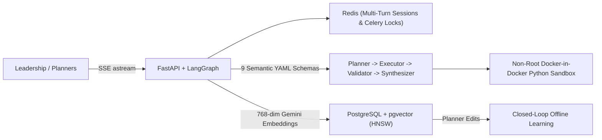
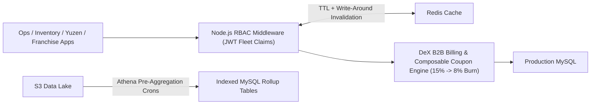

### Hi, I'm Anirudh Agrawal 👋

**Software Development Engineer — Backend & Distributed Systems** in Bengaluru | **IIT Roorkee '20** | **ex-Meragi**, **ex-Yulu (SDE II)**

I design and build production backend services, multi-tenant authorization/data platforms, and agentic AI systems in **Python (FastAPI / Django)**, **Java 21 (Spring Boot)**, and **Node.js**.

#### What I've Built in Production
- **Backend & Production AI Systems (Meragi Celebrations):**
  - Built an autonomous **NL-to-SQL & Python Analytics Agent** in `FastAPI` + `LangGraph` (*Planner → Executor → Validator → Synthesizer* over 9 semantic YAML schemas) with a non-root **Docker-in-Docker** sandbox, real-time **SSE streaming** (`graph.astream`), and `Redis` multi-turn sessions for leadership analytics.
  - Shipped a production **AI Bill of Materials (BOM) Platform** combining 768-dim Gemini embeddings, **PostgreSQL `pgvector` HNSW** search, a 3-node cyclic generation graph, a **Supervisor-routed 4-worker BOM Chat** copilot, and closed-loop offline learning from planner edits.
  - Built a customer-facing **WhatsApp AI sales agent** (`wwebjs` → `wuzapi`) with an **async burst debouncer** (LRU webhook idempotency, jittered `asyncio.Task` coalescing, per-chat `in_flight` guards), `django-rest-knox` multi-device **2FA/OTP & field-level PII masking**, **Redis distributed Celery `@singleton` locks** (`SET NX EX`), deterministic Purchase Order locking, and **Uber H3** spatial indexing.
- **Multi-Tenant Platform, Rule Engines & Data Pipelines (Yulu Bikes):**
  - Built a centralized **Node.js RBAC service** with `Redis` caching across internal ops, inventory, and field-ops (Yuzen) apps; extended it with **fleet-scoped multi-tenant isolation** (`JWT` fleet claims + TTL `Redis` cache with write-around invalidation) and launched on-site in **Indore** (replicated across **20–30 cities**).
  - Re-architected a flat legacy `coupons` table into a normalized, metadata-driven **Coupon & Rule Engine** (*services, benefits, coupon- and benefit-scoped constraints*) across ops, coupon service, and customer app—enabling zero-deploy cohort targeting & caps that helped cut promotional burn from **15% → 8%**.
  - Split the external **Yulu DeX** corporate backend (~60% revenue) from internal admin services, remediated an IDOR flaw (`corp_id` bound into signed tokens + `sessionStorage` tab isolation), built a prorated/prepaid B2B billing cron, and built **Amazon Athena → MySQL** pre-aggregation crons eliminating live 100K+-row dashboard scans.

#### Production Architecture Snapshots

**1. Meragi — Autonomous SQL Analyst V2 & Production AI BOM Platform**

**2. Yulu — Fleet-Scoped RBAC, Composable Coupon Engine & Athena Rollups**

#### Core Stack
`Python (3.11/3.12)` · `Java 21` · `TypeScript` · `FastAPI` · `Django 4.2/DRF` · `Node.js` · `Spring Boot 3.x` · `LangGraph` · `PostgreSQL (pgvector HNSW)` · `MySQL` · `Redis` · `Celery` · `Docker` · `AWS (S3, EC2, Athena)` · `pytest` · `JUnit 5`

#### Public Java 21 Concurrent LLD & Systems Practice (7 Repos · 241 JUnit 5 Tests)
| System | Core Focus | Tests |
| :--- | :--- | :--- |
| [`QuickCommerceLLDDesign`](https://github.com/aniagra119/QuickCommerceLLDDesign) | Geospatial rider dispatch, GPS ping ingestion, atomic inventory reservation | 16 JUnit 5 |
| [`BookMyShowLLDDesign`](https://github.com/aniagra119/BookMyShowLLDDesign) | Seat-lock TTL concurrency, show-seat state machine & dynamic pricing | 15 JUnit 5 |
| [`UdemyLLDDesign`](https://github.com/aniagra119/UdemyLLDDesign) | 10 cohesive GoF patterns (Composite, State, Chain, Adapter, Command) | 41 JUnit 5 |
| [`RestaurantLLDDesign`](https://github.com/aniagra119/RestaurantLLDDesign) | POS state machine, KDS Observer event bus, split-payment & SQL DDL | 52 JUnit 5 |
| [`ParkingLotLLDDesign`](https://github.com/aniagra119/ParkingLotLLDDesign) | Multi-floor allocation, slab pricing, Decorator amenities & SQL DDL | 70 JUnit 5 |
| [`ElevatorLLDDesign`](https://github.com/aniagra119/ElevatorLLDDesign) | Multi-car LOOK/SCAN scheduling (`ConcurrentSkipListSet`) & safety states | 35 JUnit 5 |
| [`ChessLLDDesign`](https://github.com/aniagra119/ChessLLDDesign) | 64-bit bitboard move masks & game state machine | 12 JUnit 5 |

📫 **Connect:** [LinkedIn](https://www.linkedin.com/in/anirudh119/) · [LeetCode (950+ total DSA/SQL across Scaler & LeetCode)](https://leetcode.com/u/Anirudh119/)
